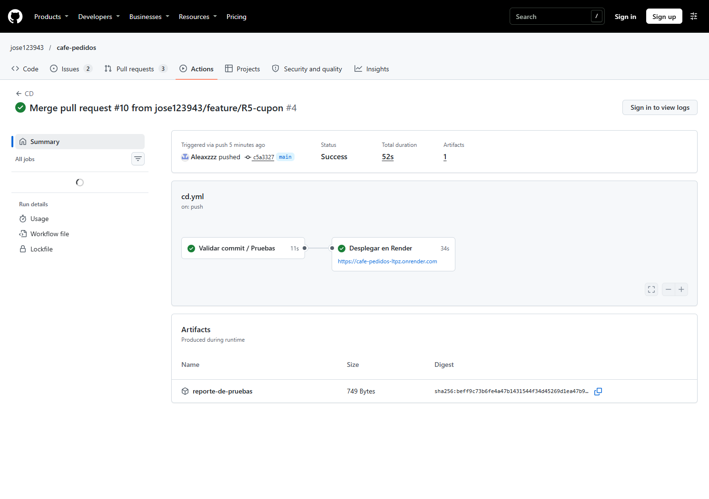
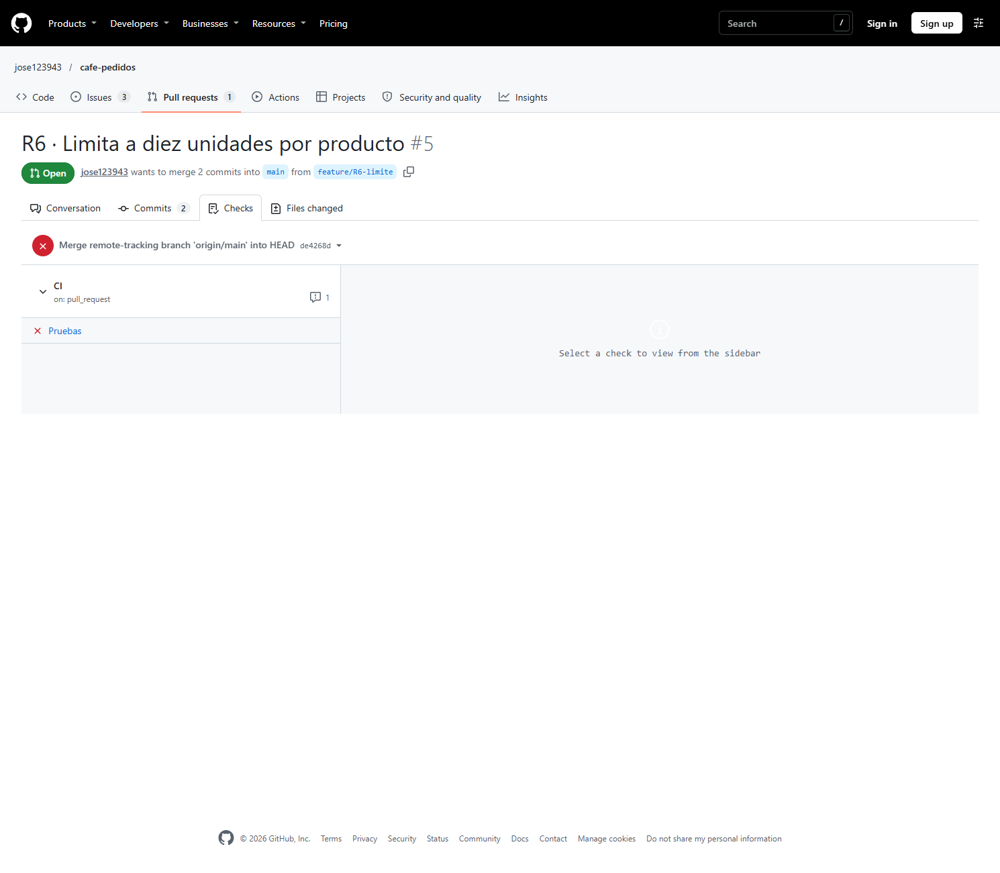

# Entrega Moodle · Café La Montaña

## Estado del sprint

La versión candidata reúne R4, R5, R6 y las pruebas de integración de QA. La suite pasó 34 pruebas en GitHub Actions y volvió a pasar en local tras el ajuste de QA. [Código completo de la candidata](https://github.com/jose123943/cafe-pedidos/tree/integracion/entrega-candidata) · [PR de validación #8](https://github.com/jose123943/cafe-pedidos/pull/8)

R4 y R5 están integradas y desplegadas en Render en `c5a3327`. R6 se actualizó con ambas historias, pasó 26 pruebas y tiene una solicitud de revisión para Endy. Quedan por integrar R6 y QA y verificar el despliegue completo. [R4 · PR #11](https://github.com/jose123943/cafe-pedidos/pull/11) · [R5 · PR #10](https://github.com/jose123943/cafe-pedidos/pull/10) · [R6 · PR #5](https://github.com/jose123943/cafe-pedidos/pull/5) · [QA · PR #7](https://github.com/jose123943/cafe-pedidos/pull/7)

## Integrantes

| Nombre | Rol | Historia o responsabilidad |
| --- | --- | --- |
| Jose David Perea | Integrador / DevOps | R6, GitHub, CI/CD y Render |
| Luis Alejandro Ariza | Desarrollador 1 | R4 |
| Endy Josue Parody | Desarrollador 2 | R5 |
| Alex Cardona Ocampo | QA/PO | Issues, pruebas de integración y demo |

## Enlaces

- **Repositorio público de GitHub** · [jose123943/cafe-pedidos](https://github.com/jose123943/cafe-pedidos)
- **Swagger de la API** · [Abrir `/docs` en Render](https://cafe-pedidos-ltpz.onrender.com/docs)
- **Etiqueta `v1.1.0`** · Pendiente del despliegue final.

## Capturas de GitHub Actions

### Último despliegue CD exitoso

El CD de R5 publicó `c5a3327` en Render. La API devolvió 35.000 COP con `CAFE10` sobre 50.000 COP, total cero sobre 9.500 COP y HTTP 400 con un cupón inválido. [Resumen de CD](https://github.com/jose123943/cafe-pedidos/actions/runs/46169557746) · [Prueba de humo](https://github.com/jose123943/cafe-pedidos/actions/runs/46169557746/job/141054706476)

### PR bloqueado por pruebas fallidas

En el PR de R6, el check obligatorio `Pruebas` quedó en rojo con 2 fallos y 15 pruebas correctas en el commit `de4268d`. Los dos casos comprobaron el rechazo de once unidades de un producto. [PR de R6](https://github.com/jose123943/cafe-pedidos/pull/5) · [Pruebas en rojo](https://github.com/jose123943/cafe-pedidos/actions/runs/46043974732/job/140658477247)

La captura muestra la pestaña Checks del PR #5 en `de4268d`. GitHub registró el estado `blocked` para ese commit. La captura complementaria de la ejecución de Actions está en `reportes/evidencias/ci-r6-rojo.png` en la copia local.

## Retrospectiva

1. **¿En qué momento una prueba evitó que avanzara un error?** GitHub bloqueó el PR de R6 cuando dos pruebas mostraron que todavía se aceptaban 11 tintos, tanto en una línea como repartidos en dos. El mismo PR pasó las 17 pruebas después de incorporar la validación. [PR de R6](https://github.com/jose123943/cafe-pedidos/pull/5)
2. **¿Dónde apareció el conflicto y cómo se resolvió?** Al actualizar R6 con `main` después de integrar R4 y R5, Git marcó `app/calculadora.py`. Se conservaron la fecha única de Bogotá, el cupón y el límite acumulado por producto. Pasaron 26 pruebas tras resolver el conflicto. [Commit de resolución](https://github.com/jose123943/cafe-pedidos/commit/2220db894622db47312d20ec8cfd22d1f7e304e6) · [CI de R6](https://github.com/jose123943/cafe-pedidos/actions/runs/46169876946/job/141055661577)
3. **¿Cuánto tardó un cambio desde el merge hasta producción?** Pasaron 54 segundos desde que se integró R5 hasta que la prueba de humo confirmó el commit `c5a3327` en Render. [PR de R5](https://github.com/jose123943/cafe-pedidos/pull/10) · [CD de R5](https://github.com/jose123943/cafe-pedidos/actions/runs/46169557746)
4. **¿Qué comentó un revisor que mejoró el código de otra persona?** En el PR de QA abierto por Alex, José registró una revisión técnica con Codex para verificar que el límite de R6 se aplica por producto. Se amplió la prueba para comprobar que un pedido de diez tintos y un pandebono devuelve HTTP 200 y un total de 33.500 COP. [Revisión de QA](https://github.com/jose123943/cafe-pedidos/pull/7#pullrequestreview-6099133455) · [Commit del ajuste](https://github.com/jose123943/cafe-pedidos/commit/cd47e2fea622bed5dfd50b5d3b162c01aa509c45)
5. **Si repitieran el sprint, ¿qué cambiarían en el orden de integración?** La propuesta para acordar con el equipo es integrar primero R4 y R5, y actualizar R6 después de ambos merges para revisar juntas sus diferencias. R4 y R5 se combinaron sin conflicto en el ensayo de ramas. Las dos combinaciones que incluían R6 marcaron `app/calculadora.py`. [Comparación en la auditoría](AUDITORIA_FINAL.md#ensayo-con-las-ramas-publicadas)
